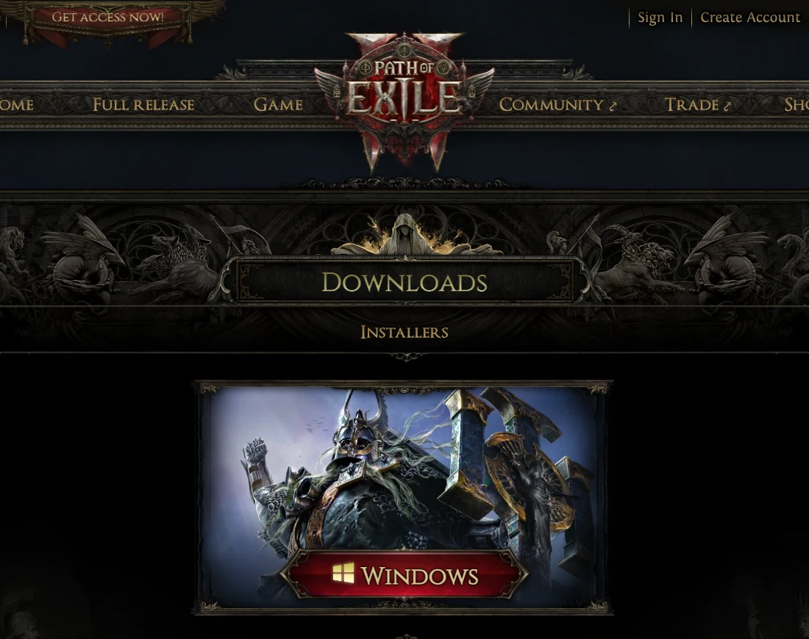
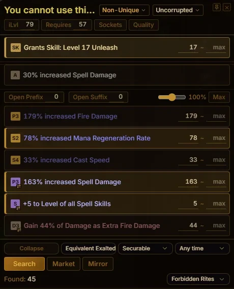
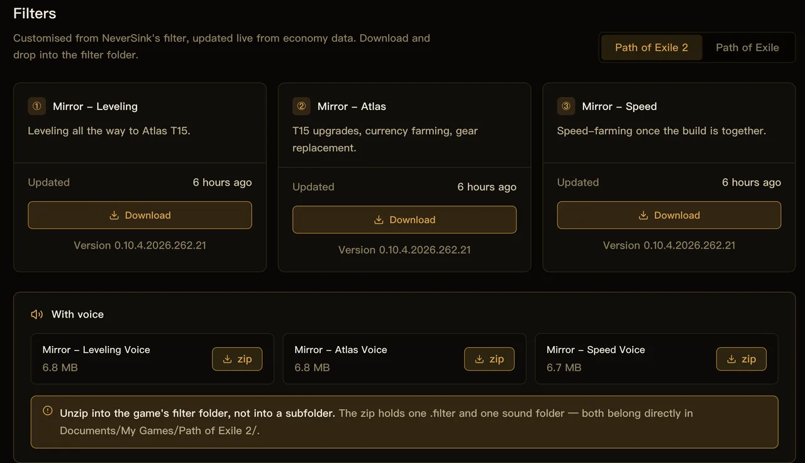
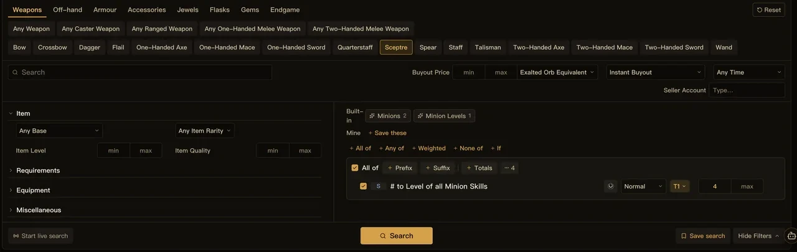
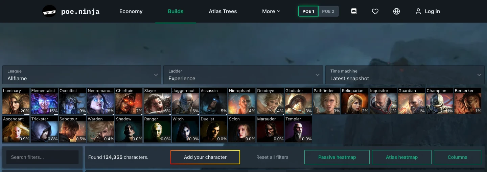
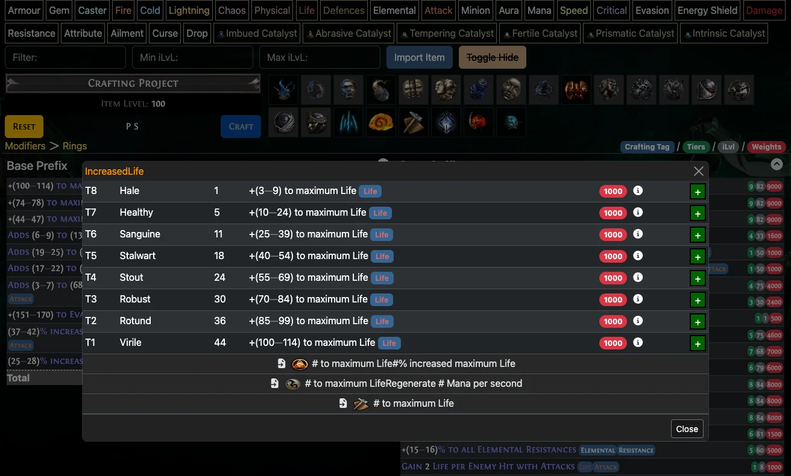

<a href="/en/">Mirror</a> / <a href="/en/guide/">Guides</a>

# Getting Started with Path of Exile: Downloads, Essential Tools, and Trading

Alongside the game client, a loot filter, a price checker, and a trading interface are useful additions to your setup. This guide covers downloads, essential tools, and reference sites for both Path of Exile 1 and Path of Exile 2.

We develop Mirror, which is used for the price-checking, filter, and trading examples below.

## 1. Create an account and download the game

- [Path of Exile 1: pathofexile.com](https://www.pathofexile.com/)
- [Path of Exile 2: pathofexile2.com](https://pathofexile2.com/)

Use **Create Account** on the relevant official site, then download the client. Check the site's current access requirements before purchasing anything.

<figure class="guide-figure">
<picture><source type="image/avif" srcset="/shots/guides/international-starter/poe1-entry.avif"></picture>
<figcaption>POE1: Create Account is at the upper left. Use the PC button for the Windows client.</figcaption>
</figure>

<figure class="guide-figure">
<picture><source type="image/avif" srcset="/shots/guides/international-starter/poe2-download.avif"></picture>
<figcaption>POE2: choose Windows on the official <a href="https://pathofexile2.com/download" target="_blank" rel="noopener noreferrer">download page</a>.</figcaption>
</figure>

For a first character, consider the current league's standard, non-hardcore mode. If you want to trade with other players, do not select Solo Self-Found (SSF).

## 2. Essential tools

Price checking, loot filters, trading, and regex searches often involve separate tools. Mirror brings most of these into one app and supports both POE1 and POE2.

[Download Mirror](/en/download.html), then select your game, realm, and language.

### Price checking

With Mirror running, hover over an item in the game and press <kbd>Ctrl</kbd> + <kbd>E</kbd> to open the price-check overlay. Review its modifiers and search for comparable listings.

<figure class="guide-figure">
<picture><source type="image/avif" srcset="/shots/guides/international-starter/en/price.avif"></picture>
<figcaption>The price-check overlay lets you select modifiers and adjust their minimum values.</figcaption>
</figure>

Mirror automatically selects some high-value modifiers. If you are unfamiliar with an item's modifiers, you can search using the default selection.

### Loot filters

A loot filter changes item labels, highlights useful drops, and hides items you no longer need. Start with a leveling filter, then switch to a stricter version as your gear and farming speed improve.

Mirror provides a filter installation option in the client. You can also download filter files manually from the [filter page](https://trade.kalandraeye.com/filters).

<figure class="guide-figure">
<picture><source type="image/avif" srcset="/shots/en/web-filter.avif"></picture>
<figcaption>Select your game, then choose a filter version. This screenshot shows POE2.</figcaption>
</figure>

After installation, select the filter in the game's settings to enable it. The client's one-click installation requires sign-in and an active plan; manual filter downloads are also available.

### Mirror Market

[Mirror Market](https://trade.kalandraeye.com/) lets you search for equipment by category, modifiers, and budget.

Once you select an item category, it removes modifiers that cannot appear on that category. This narrows the list before you add your search conditions.

For example, to find a ring with life and resistances:

1. Select your game, realm, and league.
2. Choose rings and add life and resistance requirements.
3. Set minimum values and a maximum price, then search.
4. Check the item's attributes and requirements before contacting the seller.

<figure class="guide-figure">
<picture><source type="image/avif" srcset="/shots/guides/international-starter/en/market.avif"></picture>
<figcaption>The market search form. This screenshot shows a weapon search; select the appropriate category for rings.</figcaption>
</figure>

Mirror Market uses official trade data. Keep the Mirror client running while searching.

### Other tools

Mirror also includes market prices, currency exchange ratios, regex tools, quick-reference images, timers, and profit tracking. See the [client overview](/en/client.html) for feature availability in each game.

## 3. Useful websites

### poe.ninja: popular classes and builds

[poe.ninja](https://poe.ninja/)

You can check market prices in Mirror. Use poe.ninja to explore popular classes, skills, and builds, or inspect individual characters' equipment, gems, and passive trees.

<figure class="guide-figure">
<picture><source type="image/avif" srcset="/shots/guides/international-starter/en/ninja-builds.avif"></picture>
<figcaption>The <a href="https://poe.ninja/poe1/builds" target="_blank" rel="noopener noreferrer">Builds page</a>: choose a league and class, then filter by skill. Switch games at the top.</figcaption>
</figure>

### PoEDB: items, skills, and modifiers

[POE1 database](https://poedb.tw/us/) · [POE2 database](https://poe2db.tw/us/)

Look up item bases, uniques, skills, monsters, and modifiers. For crafting or item evaluation, the modifier tables show which modifiers can appear, their tiers, required item levels, value ranges, and weights.

<figure class="guide-figure">
<picture><source type="image/avif" srcset="/shots/guides/international-starter/en/poedb-modifiers.avif"></picture>
<figcaption>On the <a href="https://poedb.tw/us/Rings#ModifiersCalc" target="_blank" rel="noopener noreferrer">ring modifier page</a>, click a modifier to see its available tiers.</figcaption>
</figure>

Screenshots illustrate the interfaces; league names, versions, and prices shown are not live data. Click an image to enlarge it.

---

**Related guides:** [Price checking](/en/guide/price-check.html) · [Installing a loot filter](/en/guide/loot-filter.html) · [Using Mirror Market](/en/guide/market.html)
