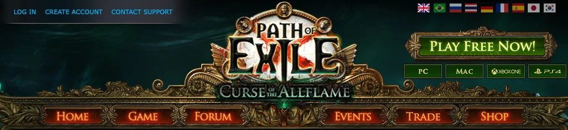
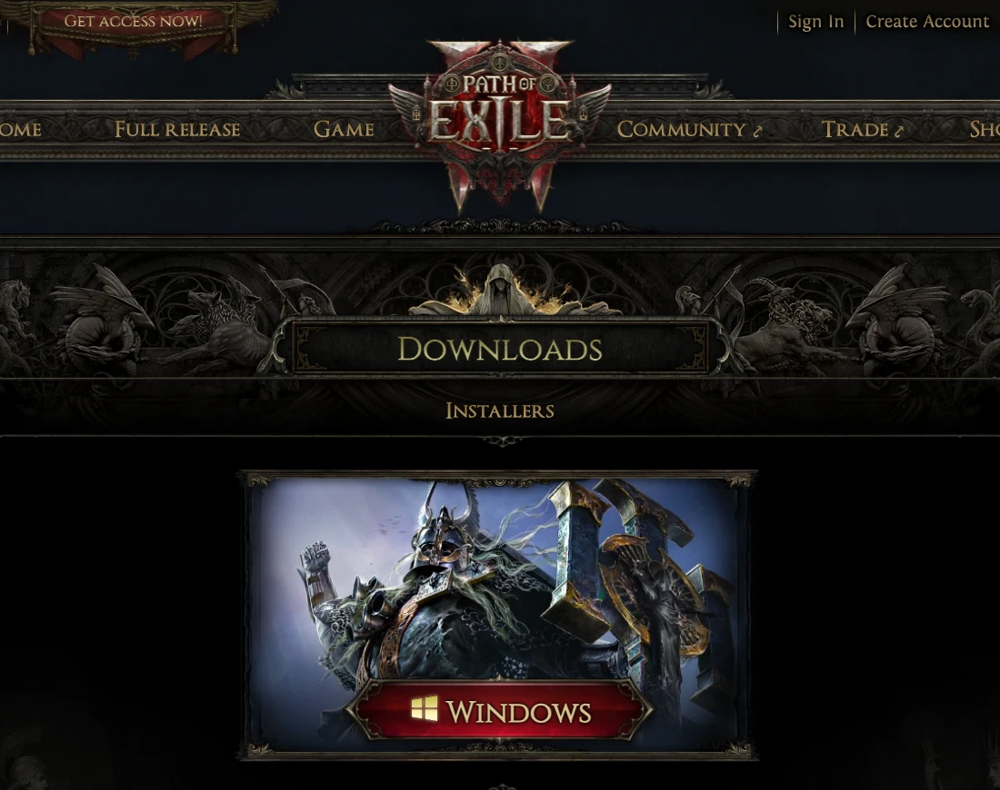
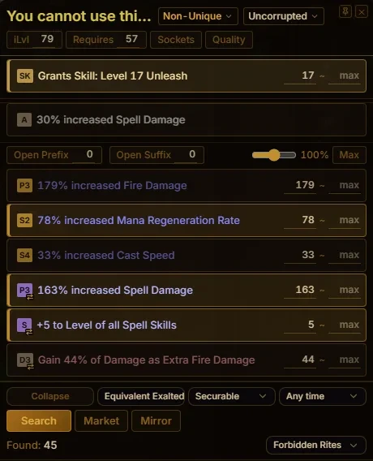
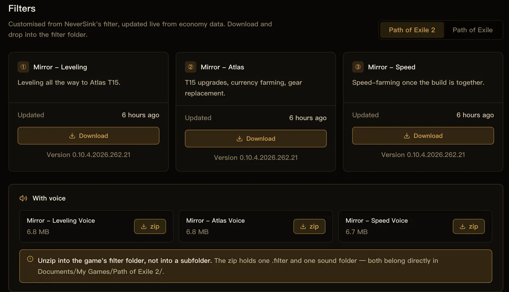
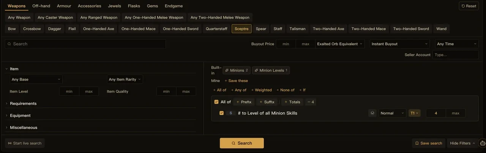
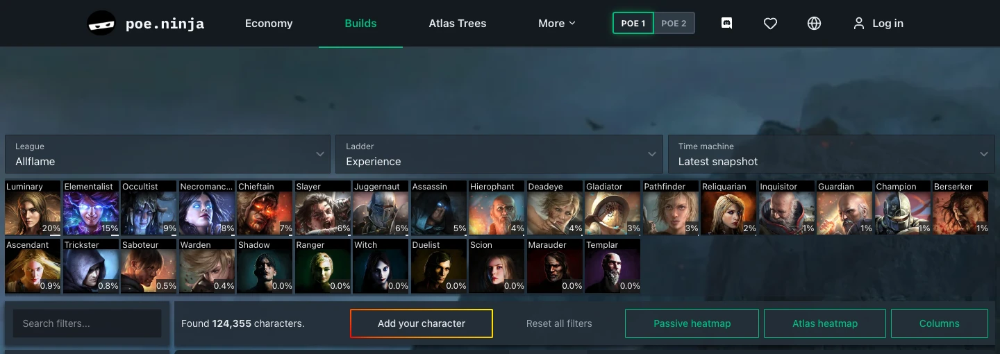
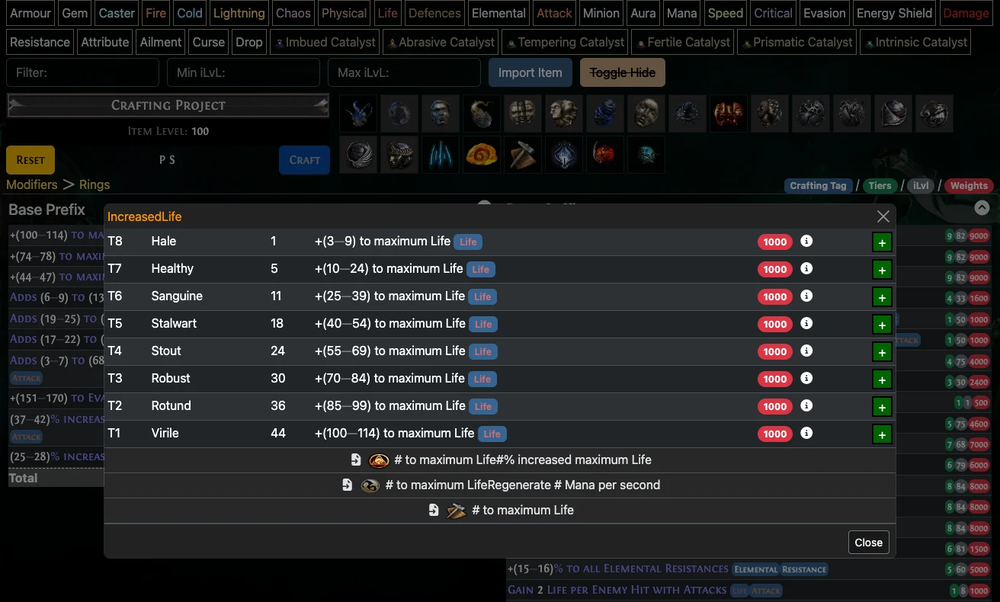

<a href="/en/">Mirror（英語）</a> / <a href="/en/guide/">ガイド（英語）</a>

# Path of Exileの始め方：ダウンロード・便利なツール・トレード

ゲームクライアントに加えて、アイテムフィルター、価格チェックツール、トレード用の検索画面を用意しておくと便利です。このガイドでは、Path of Exile 1とPath of Exile 2のダウンロード方法、便利なツール、情報サイトを紹介します。

当サイトではMirrorを開発しています。以下の価格チェック、フィルター、トレードの説明にはMirrorを使用します。

## 1. アカウントを作成してゲームをダウンロードする

- [Path of Exile 1：pathofexile.com](https://www.pathofexile.com/)
- [Path of Exile 2：pathofexile2.com](https://pathofexile2.com/)

それぞれの公式サイトの **Create Account** からアカウントを作成し、クライアントをダウンロードします。購入する場合は、先に公式サイトで現在のプレイ条件を確認してください。

<figure class="guide-figure">
<picture><source type="image/avif" srcset="/shots/guides/international-starter/poe1-entry.avif"></picture>
<figcaption>POE1：左上のCreate Accountでアカウントを作成します。Windows版クライアントはPCボタンからダウンロードできます。</figcaption>
</figure>

<figure class="guide-figure">
<picture><source type="image/avif" srcset="/shots/guides/international-starter/poe2-download.avif"></picture>
<figcaption>POE2：公式の<a href="https://pathofexile2.com/download" target="_blank" rel="noopener noreferrer">ダウンロードページ</a>でWindowsを選びます。</figcaption>
</figure>

最初のキャラクターは、現在のリーグの通常モード（ハードコアではないモード）がおすすめです。他のプレイヤーとトレードしたい場合は、Solo Self-Found（SSF）を選ばないでください。

## 2. 便利なツール

価格チェック、アイテムフィルター、トレード、正規表現検索には、それぞれ別のツールが使われることもあります。Mirrorはその多くをひとつのアプリにまとめ、POE1とPOE2の両方に対応しています。

[Mirrorをダウンロード](/en/download.html)（英語ページ）し、ゲーム、レルム、言語を選択します。

### 価格チェック

Mirrorを起動した状態で、ゲーム内のアイテムにカーソルを合わせて<kbd>Ctrl</kbd> + <kbd>E</kbd>を押すと、価格チェック画面が開きます。モッドを確認し、条件の近い出品を検索できます。

<figure class="guide-figure">
<picture><source type="image/avif" srcset="/shots/guides/international-starter/en/price.avif"></picture>
<figcaption>価格チェック画面では、モッドを選択し、それぞれの下限値を調整できます。</figcaption>
</figure>

Mirrorは価値の高いモッドを一部自動で選択します。モッドに詳しくなくても、初期選択のまま検索できます。

### アイテムフィルター

アイテムフィルターはドロップのラベル表示を変更し、有用なアイテムを目立たせ、不要なアイテムを非表示にします。まずはレベリング用を使い、装備や周回速度が向上したら、表示対象を絞ったものに切り替えましょう。

Mirrorのクライアントにはフィルターのインストール機能があります。[フィルターページ](https://trade.kalandraeye.com/filters)からファイルを手動でダウンロードすることもできます。

<figure class="guide-figure">
<picture><source type="image/avif" srcset="/shots/en/web-filter.avif"></picture>
<figcaption>ゲームを選び、用途に合うフィルターを選択します。画像はPOE2の画面です。</figcaption>
</figure>

インストール後、ゲーム内の設定でフィルターを選択して有効にします。クライアントのワンクリックインストールにはログインと有効な利用プランが必要です。フィルターの手動ダウンロードも利用できます。

### Mirror Market

[Mirror Market](https://trade.kalandraeye.com/)では、カテゴリ、モッド、予算を指定して装備を検索できます。

アイテムのカテゴリを選ぶと、そのカテゴリに付かないモッドが候補から除外されます。検索条件を追加する前に、モッドの候補を絞り込めます。

たとえば、ライフと耐性の付いた指輪を探す場合は、次のように操作します。

1. ゲーム、レルム、リーグを選択します。
2. 指輪のカテゴリを選び、ライフと耐性の条件を追加します。
3. 各モッドの下限値と価格の上限を設定し、検索します。
4. アイテムの性能と装備要件を確認してから、出品者に連絡します。

<figure class="guide-figure">
<picture><source type="image/avif" srcset="/shots/guides/international-starter/en/market.avif"></picture>
<figcaption>マーケットの検索フォーム。画像は武器の検索画面です。指輪を探す場合は、対応するカテゴリを選んでください。</figcaption>
</figure>

Mirror Marketは公式トレードデータを使用します。検索中はMirrorのクライアントを起動しておいてください。

### その他のツール

Mirrorには相場情報、通貨の交換比率、正規表現ツール、早見表、タイマー、収益記録もあります。ゲームごとの対応機能は[クライアント紹介](/en/client.html)（英語）をご覧ください。

## 3. 役立つ情報サイト

### poe.ninja：人気のクラスとビルド

[poe.ninja](https://poe.ninja/)

相場はMirrorで確認できます。poe.ninjaでは人気のクラス、スキル、ビルドを調べたり、個々のキャラクターの装備、ジェム、パッシブツリーを確認したりできます。

<figure class="guide-figure">
<picture><source type="image/avif" srcset="/shots/guides/international-starter/en/ninja-builds.avif"></picture>
<figcaption><a href="https://poe.ninja/poe1/builds" target="_blank" rel="noopener noreferrer">Buildsページ</a>でリーグとクラスを選び、スキルで絞り込みます。ゲームは画面上部で切り替えられます。</figcaption>
</figure>

### PoEDB：アイテム・スキル・モッドのデータ

[POE1データベース（日本語）](https://poedb.tw/jp/) · [POE2データベース（日本語）](https://poe2db.tw/jp/)

アイテムベース、ユニーク、スキル、モンスター、モッドを調べられます。クラフトやアイテムの評価にはモッド表が役立ちます。付与されるモッドの種類、ティア、必要なアイテムレベル、数値の範囲、抽選の重みを確認できます。

<figure class="guide-figure">
<picture><source type="image/avif" srcset="/shots/guides/international-starter/en/poedb-modifiers.avif"></picture>
<figcaption><a href="https://poedb.tw/us/Rings#ModifiersCalc" target="_blank" rel="noopener noreferrer">指輪のモッドページ（英語）</a>でモッドをクリックすると、各ティアを確認できます。</figcaption>
</figure>

掲載画像は英語版の画面です。操作の参考用であり、画像内のリーグ名、バージョン、価格は最新情報ではありません。画像をクリックすると拡大できます。

---

**関連ガイド（英語）：** [価格チェック](/en/guide/price-check.html) · [アイテムフィルターの導入](/en/guide/loot-filter.html) · [Mirror Marketの使い方](/en/guide/market.html)
