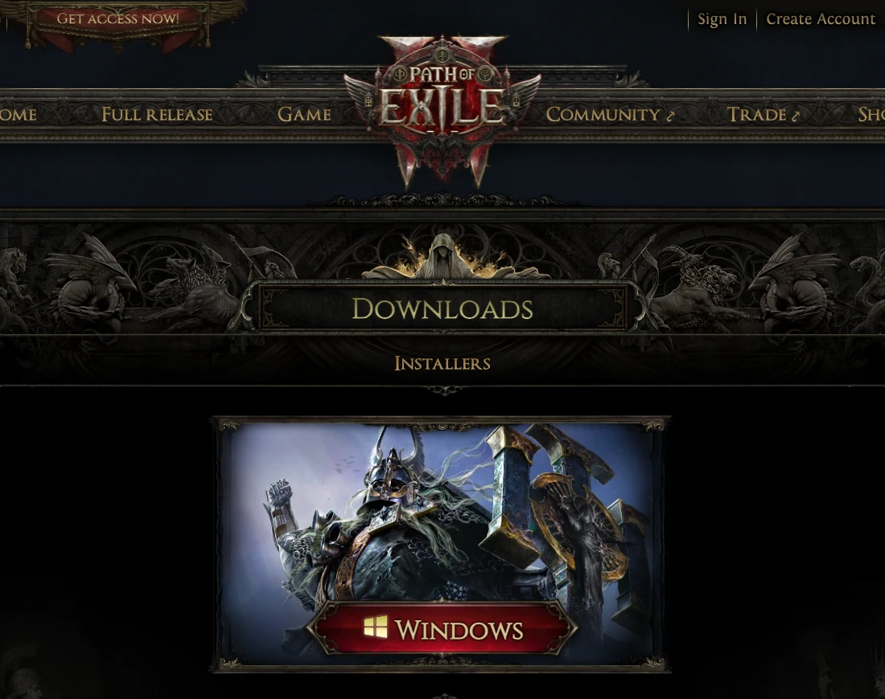
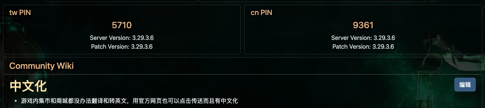
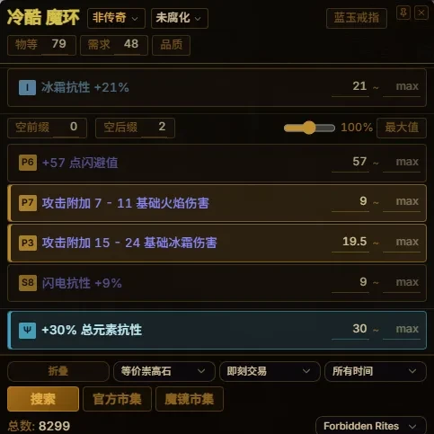
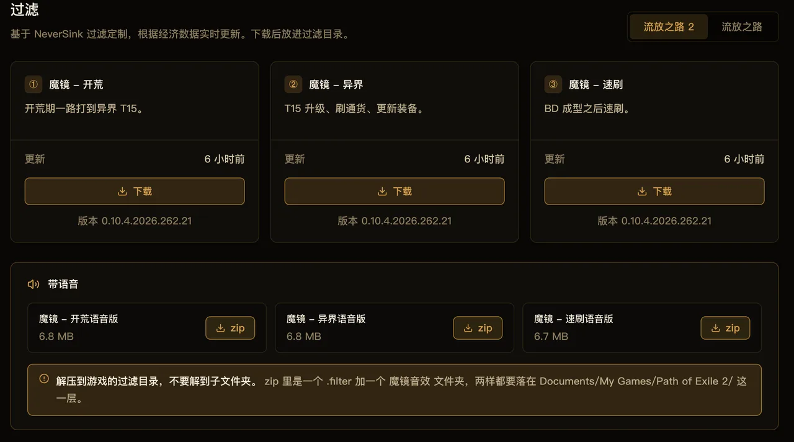
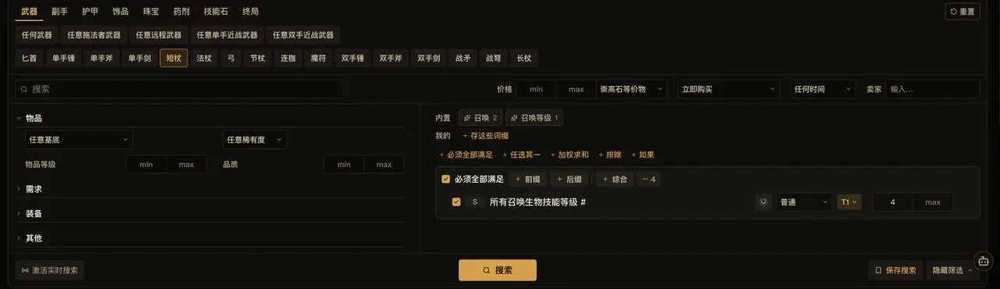
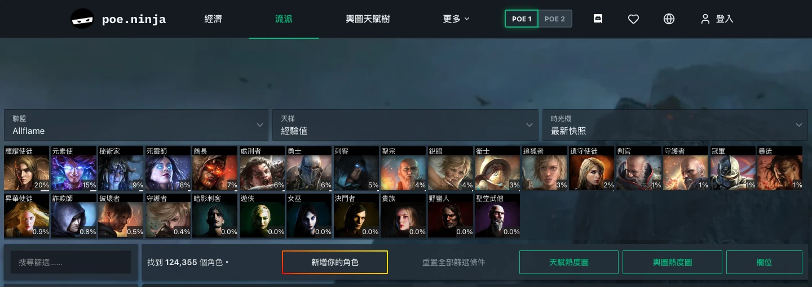
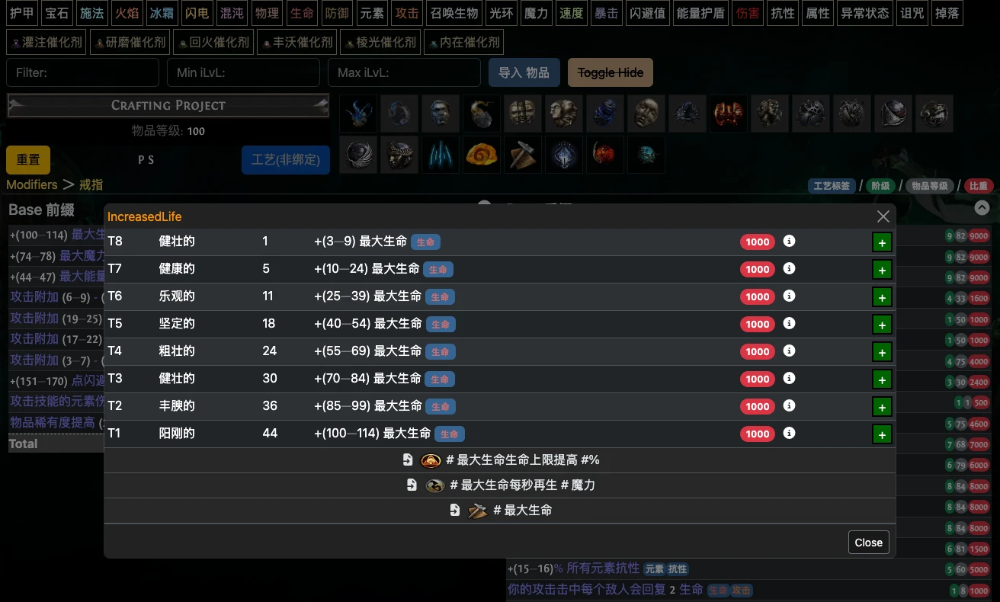

<a href="/">魔镜</a> / <a href="/guide/">使用指南</a>

# 流放之路国际服入坑指南：下载、工具与中文交易

玩国际服，除了下载游戏，通常还要准备查价工具、掉落过滤器，以及方便自己使用的交易界面。这篇整理了下载入口、常用工具和网站，POE1、POE2 玩家都可以参考。

文中会介绍我们开发的魔镜，查价、过滤器和市集部分用魔镜演示。

## 一、注册和下载

- [POE1 官网：pathofexile.com](https://www.pathofexile.com/)
- [POE2 官网：pathofexile2.com](https://pathofexile2.com/)

点击官网的 **Create Account** 注册账号，再下载客户端。是否需要购买或取得游玩资格，查看官网当前说明。

<figure class="guide-figure">
<picture><source type="image/avif" srcset="/shots/guides/international-starter/poe1-entry.avif"></picture>
<figcaption>POE1：左上角 Create Account 注册，右侧 PC 是 Windows 客户端入口。</figcaption>
</figure>

<figure class="guide-figure">
<picture><source type="image/avif" srcset="/shots/guides/international-starter/poe2-download.avif"></picture>
<figcaption>POE2：官网顶部同样有 Create Account；<a href="https://pathofexile2.com/download" target="_blank" rel="noopener noreferrer">下载页</a>选择 Windows 客户端。</figcaption>
</figure>

国内连接国际服，如果出现延迟高、切图掉线，可以尝试游戏加速器的国际服线路，并在登录界面比较不同网关的连接情况。

建角色时建议先选当前赛季的普通模式。准备和其他玩家交易的话，不要选独狼模式（SSF）。

## 二、POE1 游戏汉化

POE1 国际服需要中文界面，可以使用 [PoEDB 的中文化页面](https://poedb.tw/cn/chinese)提供的工具。下面以支持简体中文的 **VPatchGGPK3** 为例；同页的 PoeChinese3 只支持繁体。

1. 在页面找到“Pin 码 繁体中文/简体中文”，通过下载链接获取 **VPatchGGPK3_win-x64.zip**，解压。
2. 关闭游戏，打开 **VPatchGGPK.exe**。如果提示缺少运行环境，安装页面列出的 Microsoft .NET Desktop Runtime 8。
3. 选择游戏文件：独立客户端选择安装目录里的 **Content.ggpk**；Steam / Epic 客户端选择 **Bundles2** 目录里的索引文件，具体文件名按页面说明选择。
4. 语系选择 **cn**，输入 PoEDB 页面顶部当前显示的 **cn PIN**，点击“套用中文化”。
5. 看到“Done! 中文化完成!”后启动游戏，在登录界面选择第二个法国国旗切换语言。

<figure class="guide-figure">
<picture><source type="image/avif" srcset="/shots/guides/international-starter/poedb-chinese.avif"></picture>
<figcaption>PIN 会随更新变化，请使用<a href="https://poedb.tw/cn/chinese" target="_blank" rel="noopener noreferrer">页面</a>当时显示的值，不要照抄截图。</figcaption>
</figure>

游戏更新后，需要按页面说明重新汉化。该工具会修改游戏文件，存在违反游戏使用条款的风险，使用前请备份原文件。

## 三、常用工具：查价、过滤器和中文市集

查价器、过滤器、交易站汉化、正则生成器，这些通常需要分别找工具。魔镜把大部分常用功能集中到了一起，支持 POE1 和 POE2。

[下载魔镜](/download.html)。安装后选好游戏、区服和语言，先用下面这三项。

### 1. 查价

在游戏里把鼠标放到物品上，按 <kbd>Ctrl</kbd> + <kbd>E</kbd>，就能打开查价浮层，查看词缀并搜索相近物品的挂单。

<figure class="guide-figure">
<picture><source type="image/avif" srcset="/shots/guides/international-starter/price.avif"></picture>
<figcaption>查价浮层：勾选用于比较的词缀，调整数值下限后搜索。</figcaption>
</figure>

查价时，魔镜会自动选中一些高价值词缀。不熟悉装备词缀的话，可以直接使用默认选中的词缀搜索。

### 2. 掉落过滤器

过滤器用颜色、字号、提示音等方式区分掉落，也可以隐藏不需要的物品。开荒时建议用显示范围较宽的版本，等装备和刷图效率上来后，再提高严格度。

魔镜客户端有过滤器安装入口，也可以在[过滤器页面](https://trade.kalandraeye.com/filters)手动下载。

<figure class="guide-figure">
<picture><source type="image/avif" srcset="/shots/web-filter.avif"></picture>
<figcaption>先选对应游戏，再选过滤版本。图中为 POE2 页面。</figcaption>
</figure>

安装后还需要到游戏设置里选中该过滤器，才会生效。手动下载与客户端一键安装是两种方式；其中客户端一键安装需要登录并开通。

### 3. 中文市集

官方交易站可以按物品、词缀和价格搜索。不熟悉英文物品名、词缀名，可以直接用[魔镜市集](https://trade.kalandraeye.com/)的中文界面，支持英文、简中、繁中检索。

选好物品类别后，魔镜市集会先筛掉该类别不会出现的词缀，缩小可选范围，不用在几千条词缀里逐个找。

比如想买一枚补生命和抗性的戒指：

1. 选好游戏、国际服和赛季。
2. 选择戒指类别，添加生命、抗性条件。
3. 设置最低属性要求和价格上限，再搜索。
4. 查看装备属性与需求，找到合适的挂单后联系卖家。

<figure class="guide-figure">
<picture><source type="image/avif" srcset="/shots/guides/international-starter/market.avif"></picture>
<figcaption>市集筛选区。图中是武器查询，戒指需要切换到对应类别。</figcaption>
</figure>

魔镜市集使用官方交易数据，搜索时需要保持客户端运行。

### 其他功能

魔镜还集成了实时行情、通货兑换比率、正则、速查图、计时器和收益统计等功能。两代游戏的具体支持范围见[官网说明](/client.html)。

## 四、常用网站

### poe.ninja：看热门职业和 BD

地址：[poe.ninja](https://poe.ninja/)

行情可以直接在魔镜里查看。poe.ninja 主要用来了解当前赛季的热门职业、技能和 BD，也可以查看具体角色的装备、技能搭配与天赋。

<figure class="guide-figure">
<picture><source type="image/avif" srcset="/shots/guides/international-starter/ninja-builds.avif"></picture>
<figcaption><a href="https://poe.ninja/zh-tw/poe1/builds" target="_blank" rel="noopener noreferrer">poe.ninja 流派页</a>：选赛季、点职业，再按技能筛选。图中为 POE1，顶部可以切到 POE2。</figcaption>
</figure>

### PoEDB：查物品、技能和词缀数据

地址：[POE1 数据库](https://poedb.tw/cn/) · [POE2 数据库](https://poe2db.tw/cn/)

PoEDB 支持中文，可以查询装备基底、暗金物品、技能、怪物和词缀数据。比如想知道某个部位能出哪些词缀、词缀有几档、数值范围是多少，都可以在这里查。

<figure class="guide-figure">
<picture><source type="image/avif" srcset="/shots/guides/international-starter/poedb-modifiers.avif"></picture>
<figcaption><a href="https://poedb.tw/cn/Rings#ModifiersCalc" target="_blank" rel="noopener noreferrer">PoEDB 戒指词缀页</a>：点击一条词缀，可以查看各档的物品等级要求、数值范围和权重。</figcaption>
</figure>

截图仅作操作示意，其中的赛季、版本和价格不代表当前数据。点击图片可放大查看。

---

**相关教程**：[怎么查一件装备值多少钱](/guide/price-check.html) · [掉落过滤器怎么装](/guide/loot-filter.html) · [魔镜市集怎么用](/guide/market.html)
